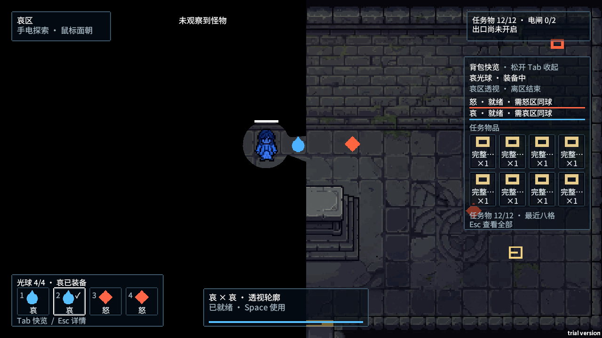
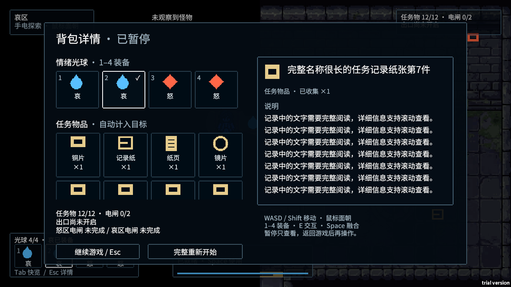

# Pool 背包系统界面说明 v1.3.1

2026-10-06。对应当前 `SampleScene` 中序列化的 uGUI 界面（`layoutVersion = 4`）。本文说明实际实现，旧 HTML 仅是历史设计示意。

## 1. 常驻 HUD

| 区域 | 内容与读法 |
|---|---|
| 左上玩家区域卡 | 当前所在怒区/哀区/过渡区及行动提示；解释玩家区域规则 |
| 右上目标卡 | 必需任务物和电闸的完成数、出口开启状态；未配置时显示已收集数和未配置说明 |
| 上方威胁提示 | 未观察到怪物/已观察到追击、奔向电闸或三倍穿障追赶；不显示隐藏怪物坐标 |
| 左下四格快捷栏 | 1–4、怒/哀图标、实际装备勾选、空格状态、光球占用数以及 Tab/Esc 提示 |
| 下方融合卡 | 当前装备能力、无效原因、动作限制、冷却和 Space 操作；透视持续时间另行显示 |
| 下方交互提示 | 本帧 E 对应的对象与结果；满栏等限制明确显示 |
| 右下操作提示 | 获得物品、装备成功、被捕、离区风险或失败信息 |

没有装备、区域不匹配和冷却中的球仍保持自己的装备状态；装备勾选不表示技能可释放。融合卡的原因和动作优先级为：结算/捕获 → 冲锋/眩晕 → 无装备/区域不匹配 → 冷却 → 就绪。

冷却进度条表示能力恢复，哀透视的持续条表示当前效果寿命。两者分别显示，效果结束不代表冷却结束。

## 2. Tab 快览

按住 Tab 展开右侧面板，松开立即关闭。内容是当前实际装备及能力提示、怒/哀各自冷却、任务物格、任务占用总数和 Esc 详情入口。

快览没有可点击装备/使用按钮，不阻挡世界瞄准和玩法按键，不暂停怪物或技能计时。按 Esc 直接从快览进入暂停详情；返回游戏后快览保持关闭，释放 Tab 后可以再次打开。

任务物按拾取顺序显示图标、简称和 `×1`；空格只显示“空”。任务格随容量变化，最多两排八格。已获得超过八件时显示最近八件，并提示“最近八格 / Esc 查看全部”；完整记录仍保存在暂停列表中。

快览名称过长时简写，详情查看完整说明。快览总数是携带量/容量，不保证等于目标卡的必需任务完成数。

## 3. Esc 暂停详情

详情页包含四格光球、可滚动的完整任务格、物品详情、任务/电闸摘要和“继续 / 重新开始”按钮。打开时世界及技能计时冻结，背景遮罩不透明度 55%。

首次打开默认查看当前装备；之后保留仍有效的查看选择。点击光球格展示能力、使用区域及回到游戏后按对应数字装备的说明；点击任务物格展示名称、类型、描述和用途；点击空格只显示尚未获得物品。

| 标记 | 含义 |
|---|---|
| 数字 1–4 | 返回玩法后装备该光球的按键 |
| 白色勾选 ✓ | 当前实际装备的光球 |
| 绿色细框/三角标记 | 正在阅读的物品，和实际装备可以不同 |
| 悬停边框 | 鼠标当前经过的可查看格子 |
| 空格文字 | 未获得物品，不预告物品名或图标 |

暂停点击只查看，不装备、不拾取、不释放技能。任务物没有装备、丢弃或消耗操作。用途区分“计入出口目标”和“本关出口不要求该物品”；修改目标成员后，已打开的详情也会刷新。超过可见范围时滚动任务格；长描述在独立详情视口中滚动。名称超过标题长度时，正文保留完整名称。

## 4. 透视标记与信息边界

哀透视有效时，标出怪物和电闸；画面内合适的位置显示轮廓，靠近画面边缘或 HUD 时显示方向标记。标记不提供寻路路线，不接收鼠标事件。离开哀区、效果超时、捕获或结算后关闭；暂停时隐藏标记并冻结效果计时。

常规威胁提示只在观察成立时变化：怪物处于相机视野、射线可达；哀区额外要求五单位内且面朝夹角不超过 35°。透视期间可以观察到怪物。这个观察模型是当前近似实现，没有完全复用实际手电遮罩。

当前标记最多 32 个，电闸没有按完成状态过滤，也没有提供“已完成”标记文案。增加大量电闸或调整可见性时需要复查这些限制。

## 5. 尺寸、透明度与反馈

下表为参考画布上的默认布局；屏幕像素尺寸随 Canvas 缩放改变。

| 面板 | 默认尺寸 |
|---|---|
| 玩家区域卡 | 212 × 64 |
| 目标进度卡 | 264 × 64 |
| 光球快捷栏 | 324 × 112 |
| 融合卡 | 352 × 82 |
| 四格 / 八格任务快览 | 270 × 290 / 270 × 370 |
| 操作提示 | 300 × 84 |
| 暂停详情主体 | 1060 × 608 |

常驻卡片和快览背景不透明度 75%；格子内部去掉重复实心填充，文字、图标和标记维持独立透明度。最低正文 16 参考像素，常驻/快览图标 32，暂停详情图标 40，详情正文 18。字体为 Noto Sans SC，许可证随工程保存在 `Art/OFL.txt`。

| 反馈 | 当前表现 |
|---|---|
| 收集/换装 | 0.25 秒格高亮；换装图标约 0.16 秒缩放 |
| 冷却自然结束 | 0.25 秒就绪闪亮；捕获清冷却不当成自然就绪 |
| 操作提示 | 约 0.12 秒淡入并轻微位移，结束前约 0.2 秒淡出 |
| Tab / Esc 打开 | 约 0.12 / 0.14 秒短淡入 |
| 关闭面板 | 立即关闭，恢复玩法所在帧阻断操作穿透 |
| 提示/界面动画 | 使用非缩放时间，暂停中界面仍可交互和播放入场反馈 |

现有截图覆盖 1280×720、1920×1080、1920×1200、2560×1080。仍需真人在追逐中检查透明背景上的阅读、手电方向理解和快捷换装；自动检查不代表这些体验已验证。

## 6. UI 制作与配置

常规版本升级原位迁移默认布局，保留已有面板、格子对象及自定义根位置；重复升级不会继续缩小。任务格按场景物品配置同步，暂停保留全部，快览最多八格。

`autoPeekHeight` 控制快览自动排布；关闭后可手工安排布局。`Pool > Inventory > Rebuild backpack UI layout` 是主动重建工具，会覆盖布局，普通构建不应借此替换美术调整。

修改 UI 引用、任务模板或输入模块后，应验证空格/满栏、Tab/Esc 转换、重复绑定、滚动、恢复帧和四种分辨率。当前构建校验会拒绝缺少必需面板、文字、按钮、光球格、任务格模板、滚动视图和 EventSystem 输入模块的已配置目标场景；界面阅读、位置合理性和完整通关仍需实测。

继续阅读：[功能说明](inventory-rules.md)、[逻辑检查报告](inventory-review.md)。
